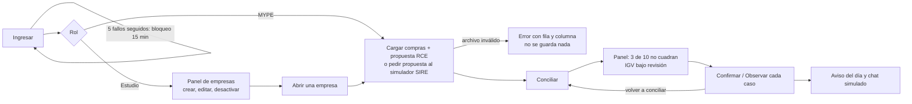
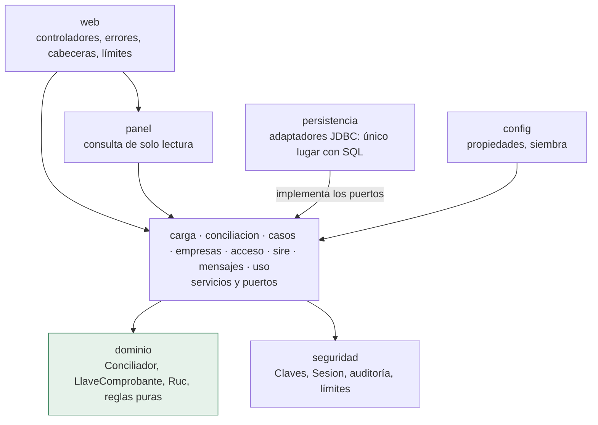
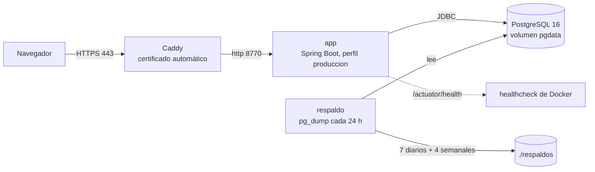
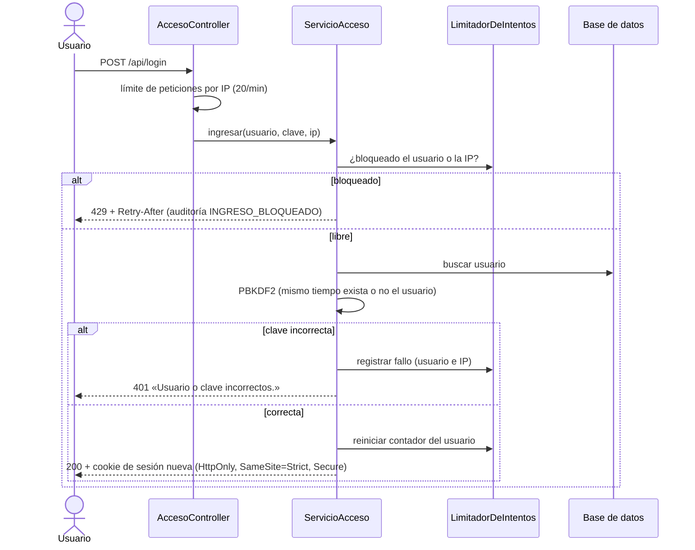
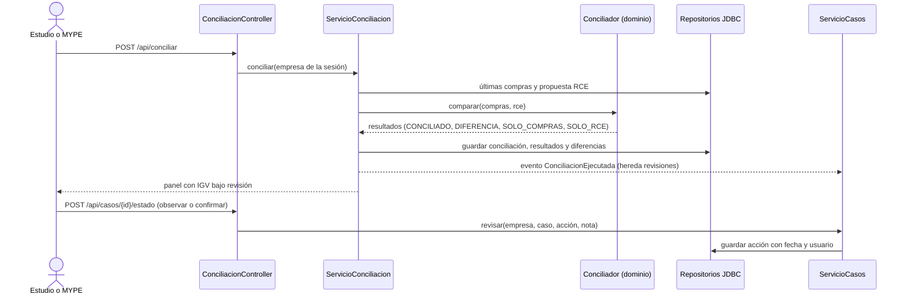
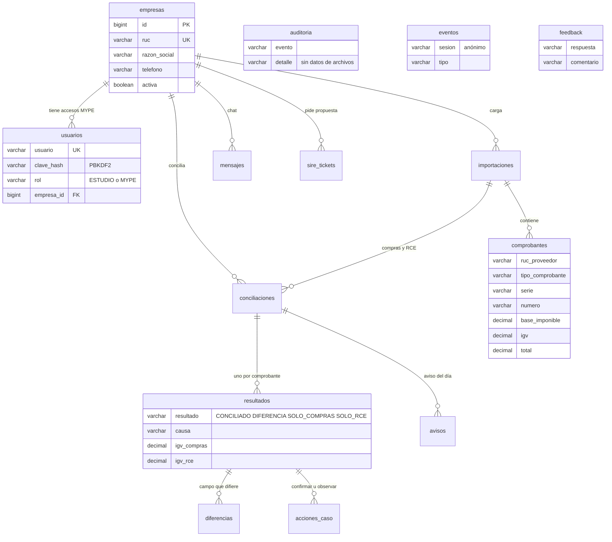

# Diagramas de Yupana (se ven en GitHub; el código es Mermaid)

## 1. Flujo del usuario

## 2. Arquitectura por capas (las flechas son dependencias)

`ArquitecturaTest` verifica: el dominio no importa Spring ni JDBC; solo `persistencia` usa SQL; la web no toca la persistencia; nadie depende de `panel`.

## 3. Despliegue

## 4. Secuencia: ingreso con bloqueo

## 5. Secuencia: conciliar y revisar un caso

## 6. Modelo de datos (ER)

